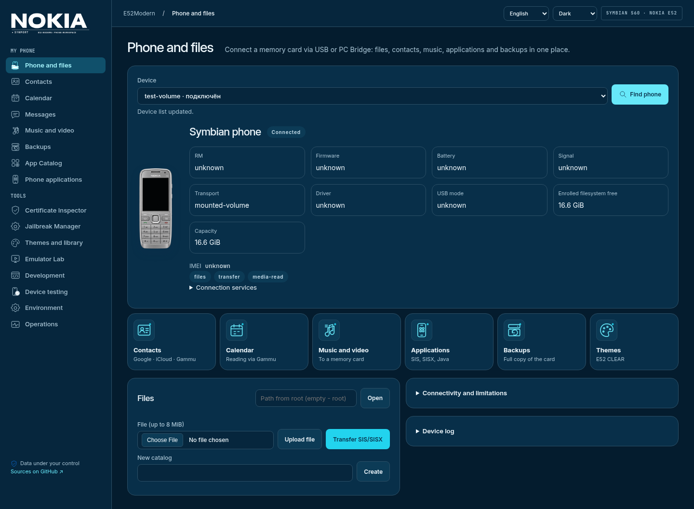
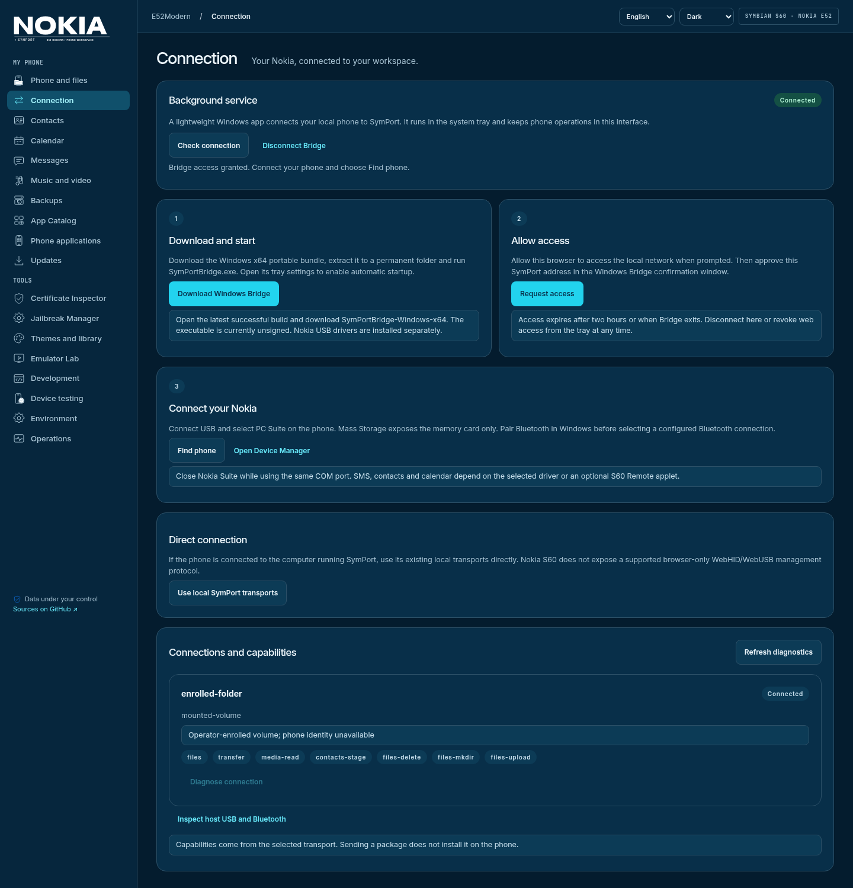
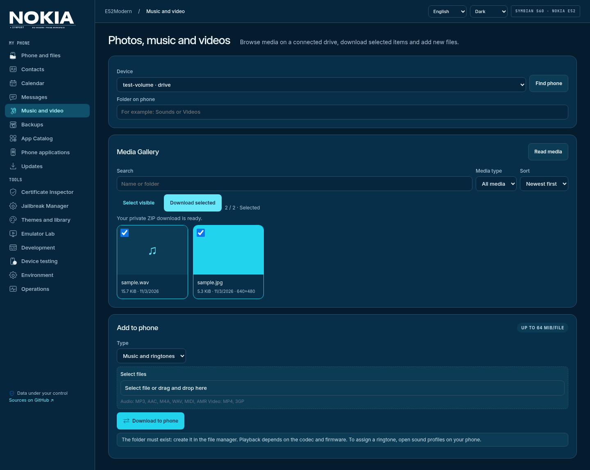
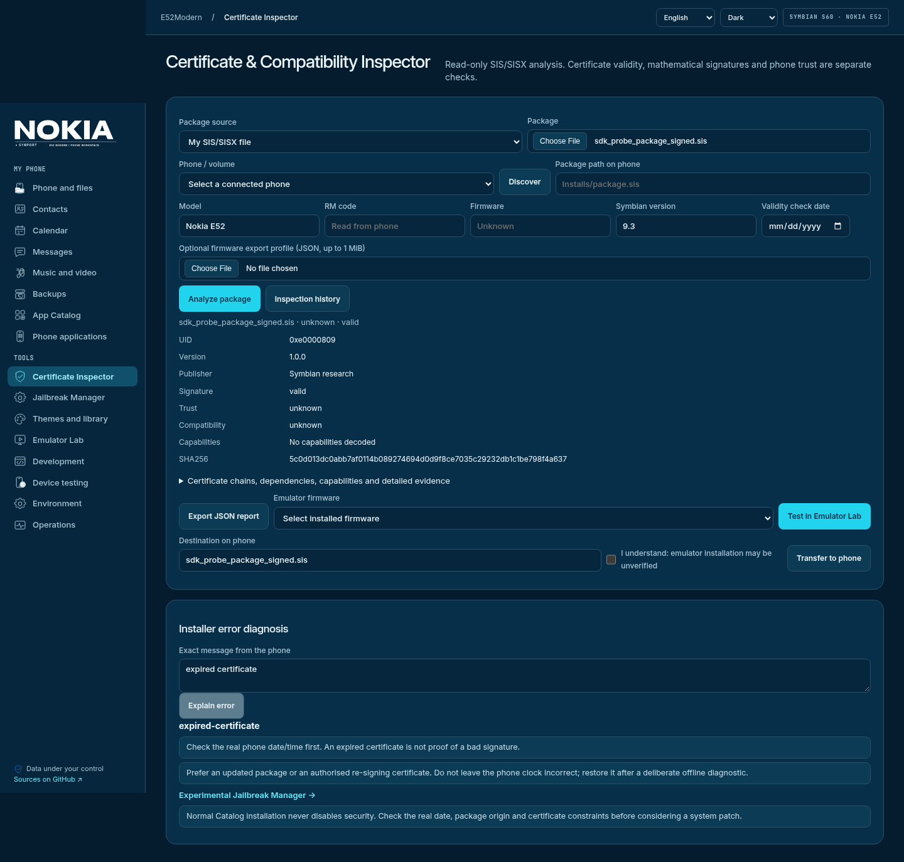

# E52Modern · SymPort

**SymPort — удобная веб-среда для телефона на Symbian.** Файлы, фотографии,
музыка, контакты, сообщения и календарь рядом с каталогом приложений,
локальной библиотекой тем и инструментами разработки.

Основной целевой телефон — **Nokia E52**, Symbian 9.3 / S60 3rd Edition FP2.
Интерфейс Nimbus поддерживает русский и английский языки, светлую и тёмную тему,
компактный вид на компьютере и телефоне.



## Подключить телефон с Windows

[Скачать Windows Bridge](https://github.com/grayhex/e52modern/actions/workflows/windows-bridge.yml) →
последняя успешная сборка → **SymPortBridge-Windows-x64**. Распакуйте архив,
запустите `SymPortBridge.exe`, затем откройте **Подключение → Запросить доступ**
в SymPort и подтвердите адрес в окне Windows. Настройки и автозапуск — в трее.

USB PC Suite, доступная карта памяти и настроенные Bluetooth/Gammu/OBEX-подключения
используют один Device Manager. Возможности определяются ответами транспорта;
передача SIS/JAR остаётся отдельной от установки на телефоне.
[Инструкция Windows](docs/WINDOWS_BRIDGE.md) · [Транспорты и совместимость](docs/TRANSPORTS.md).



## Возможности

| Раздел | Что можно делать |
|---|---|
| Подключение | Windows Bridge в трее: скачивание, подтверждение доступа, диагностика USB/Bluetooth и подключение к удалённому SymPort без входящего порта на ПК |
| Телефон | Видеть модель, RM, прошивку, батарею, сигнал, память, доступный счётчик часов и возможности подключения. IMEI скрыт; недоступные показатели — значок «Нет данных» |
| Updates | Сравнивать версию прошивки с локальной базой E52/E72; раздел установки пока недоступен |
| Файлы | Просматривать подключённый накопитель, создавать папки, загружать и скачивать файлы, подтверждать удаление |
| Медиагалерея | Искать фото, видео и музыку, смотреть миниатюры и метаданные, фильтровать, сортировать, выбирать несколько файлов и скачивать ZIP |
| Музыка и видео | Предпросмотр в браузере и передача мелодий/видео без перекодирования |
| Контакты | Читать телефонную книгу через Gammu, искать и редактировать записи, находить дубли, импортировать Google CSV / Apple и Google vCard, экспортировать и синхронизировать с предпросмотром |
| SMS | Читать доступные сообщения, искать, выбирать переписку, экспортировать JSON/CSV, сохранять копии. Отправка — только для проверенного подключения и с подтверждением |
| Календарь и задачи | Читать, искать, создавать и редактировать простые записи, импортировать/экспортировать iCalendar, разбирать конфликты перед синхронизацией |
| Резервные копии | Сохранять доступные данные; файловые копии восстанавливаются без перезаписи существующих файлов. Перед синхронизацией личных данных сохраняется исходное состояние |
| Каталог приложений | Искать программы и игры, собирать наборы, проверять пакеты и передавать их на телефон. Для ручных загрузок — ссылки на исходный источник |
| Темы | Собирать E52 CLEAR Light/Dark, загружать SIS-темы, явно публиковать в локальной библиотеке, скачивать и передавать |
| Certificate Inspector | Анализировать сертификаты, подписи, UID, зависимости и capabilities SIS/SISX, получать рекомендации по ошибкам установки и JSON-отчёт |
| Emulator Lab | Загружать собственную прошивку, управлять виртуальной E52 через EKA2L1/MGO, проверять пакеты и темы, сохранять скриншоты и отчёты |
| Разработка | Использовать SymPort CLI, SDK, сборки приложений и тем, диагностику и протокол испытаний |

Доступность контактов, SMS и календаря определяется ответами выбранного драйвера.
**USB Mass Storage предоставляет файлы, а не телефонную книгу, SMS или внутренний `C:/`.**
Если функция недоступна, интерфейс показывает причину и подходящий способ экспорта.
Передача SIS/JAR — это передача пакета; установку подтверждают на телефоне.



На снимках главной и галереи — подключённый локальный каталог с JPEG/WAV.
Сведения, которые файловое подключение не предоставляет, обозначены значком «Нет данных».

## Быстрый запуск в Docker

Нужны Docker Engine и Docker Compose v2:

```bash
git clone https://github.com/grayhex/e52modern.git
cd e52modern
tools/install.sh
```

Откройте **http://127.0.0.1:8765**. Установщик проверяет Docker, создаёт `.env`,
собирает образ и запускает сервис. Пользовательские данные сохраняются в Docker volumes.
Для обновления:

```bash
git pull
tools/install.sh
```

Не удаляйте volumes с пользовательскими данными. Другой порт задаётся через
`SYMPORT_HTTP_PORT` в `.env`. [Все варианты установки и подключения](docs/DOCKER_DEPLOYMENT.md).

## Подключить Nokia

**Телефон рядом с Linux:** подключите карту в режиме накопителя и явно укажите её
каталог через `compose.phone.yaml`. Для контактов, SMS и календаря настройте Gammu
на компьютере с телефоном.

**Телефон подключён к Windows, Docker работает на сервере:** запустите локальный
PC Bridge на Windows и соедините его с сервером через SSH. Тот же способ подходит
для локального Linux и Bluetooth. API телефона остаётся на loopback; ключ Bridge
защищает доступ.

[Пошаговое подключение Windows/Linux, USB и Bluetooth](docs/DEVICE_WORKSPACE.md#choose-the-connection)
· [PC Bridge и SSH](docs/DEVICE_MANAGER.md#windows-pc-bridge-and-remote-linux-docker).

После подключения нажмите **«Найти телефон»**. Выберите устройство и нужный раздел.
Медиагалерея использует накопитель; личные данные — отдельное подключение Gammu.

## Основные сценарии

**Контакты из Google или Apple:** экспортируйте Google CSV или vCard из облака →
откройте «Контакты» → загрузите файл → проверьте поля и выбор. Для прямой записи
нажмите «Предпросмотр синхронизации» и подтвердите показанные изменения. Если доступна
только карта памяти, передайте vCard, откройте их на Nokia и сохраните в телефонную книгу.

**Фото, музыка и видео:** выберите накопитель и папку → «Прочитать медиа» →
найдите нужные файлы → откройте предпросмотр или скачайте выбранное архивом.
Аудио и видео запрашиваются частями, если браузер поддерживает формат. Новые мелодии
и видео загружаются в существующую папку; назначение мелодии выполняется на телефоне.

**SMS и календарь:** выберите Gammu → прочитайте нужное хранилище → найдите записи
и сохраните экспорт или копию. Изменения календаря проходят через план и подтверждение;
повторное чтение проверяет результат. Сложные повторения и неподдерживаемые поля
редактируются на телефоне. Отправка SMS включается только после проверки конкретного
телефона и подключения оператором PC Bridge.

**Программы и игры:** выберите пакет в каталоге или загрузите SIS/SISX/JAR/JAD →
проверьте информацию и зависимости → при необходимости испытайте в Emulator Lab →
передайте пакет на Nokia и подтвердите установку. Если лицензия или источник требуют
ручного скачивания, используйте ссылку из карточки и общий раздел передачи пакетов.

## Emulator Lab и темы

```bash
tools/install.sh --emulator
```

Загрузите собственную прошивку через браузер, выберите устройство и запустите сеанс.
Lab использует готовый агент MGO и EKA2L1, экран 240×320, кнопки E52 и клавиатуру ПК.
Темы применяются через системное меню Symbian; запуск темы по UID не выполняется.
Результат содержит пакет, SHA-256, прошивку, установку/запуск, логи и снимки.
Из отчёта можно передать те же байты пакета на телефон.

Прошивки и результаты сохраняются между обновлениями. ROM и ключи не входят в Git
или образ. Проверка в эмуляторе и работа на физическом телефоне — разные результаты;
KEmulator для Java также не равен Symbian Java ME.
[Подключение Lab](docs/EMULATOR_LAB.md).



## Данные и подтверждения

Изменения контактов и календаря требуют актуального плана, подтверждения и копии
исходных данных. Конфликт или неполное повторное чтение останавливает операцию;
автоматического повтора и удаления записей нет. IMEI, сообщения и контакты не попадают
в обычный журнал. Приватные копии хранятся отдельно с ограниченными правами.
Не публикуйте управляющий API в интернете — используйте localhost/SSH.

**Experimental Jailbreak Manager** — отдельный добровольный мастер исследования
пакетов и действий на телефоне. Он не отключает защиту при обычной установке.
Системные действия подтверждаются отдельно; откат ограничен подтверждёнными изменениями.
[Возможности и ограничения](docs/JAILBREAK_MANAGER.md).

## Документация

- [Медиа, личные данные, безопасная синхронизация и поддержка транспортов](docs/DEVICE_WORKSPACE.md)
- [Установка Docker и удалённое подключение](docs/DOCKER_DEPLOYMENT.md)
- [Device Manager и PC Bridge](docs/DEVICE_MANAGER.md)
- [Каталог приложений](docs/APP_CATALOG.md)
- [Certificate & Compatibility Inspector](docs/CERTIFICATE_INSPECTOR.md)
- [Emulator Lab](docs/EMULATOR_LAB.md)
- [Архитектура](docs/ARCHITECTURE.md) · [Разработка и проверки](docs/DEVELOPMENT.md)

MIT. Права и условия распространения сторонних пакетов, прошивок и SDK определяются их авторами.
