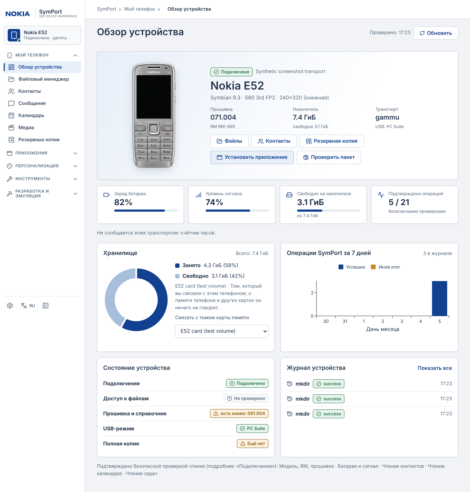
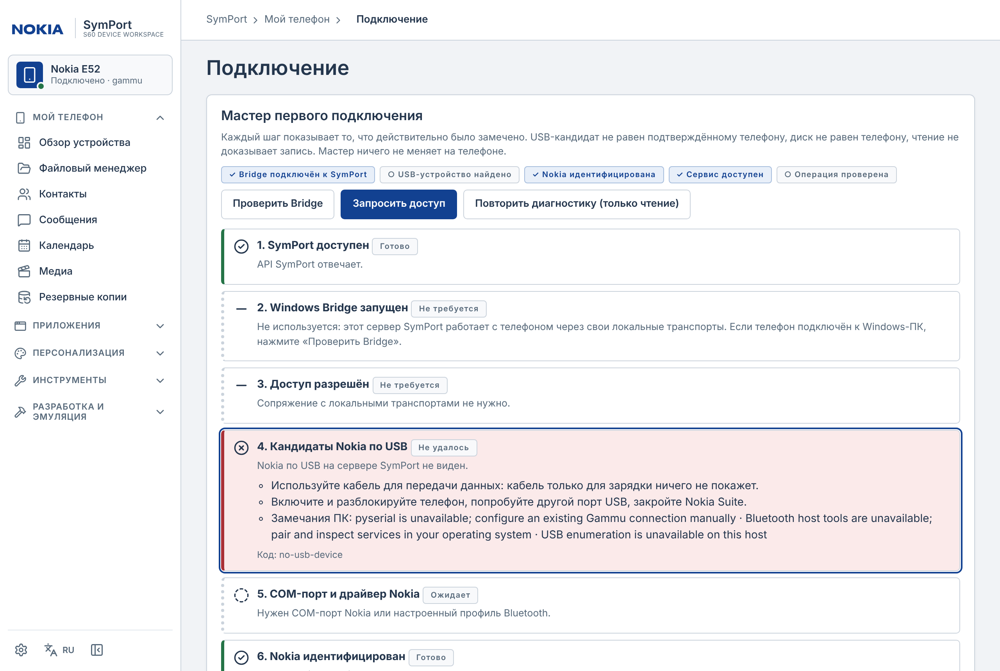
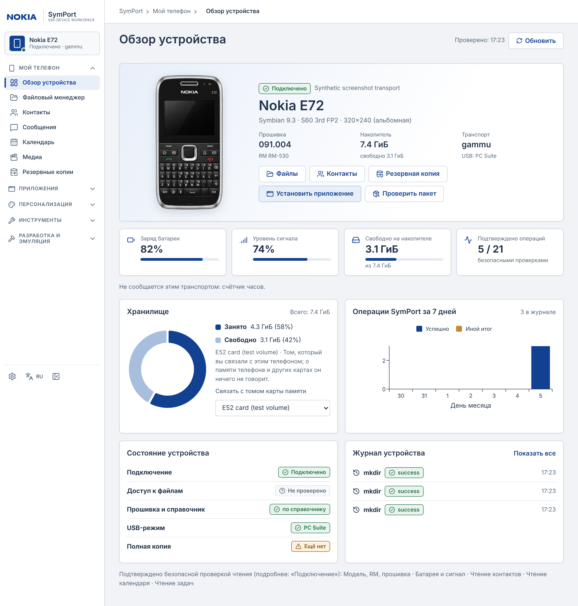

# SymPort

**Веб-пространство для Nokia E52 и E72:** телефон, файлы, контакты, музыка
и приложения — рядом с инструментами разработки для Symbian S60.
Интерфейс Nokia Classic: русский и английский, светлая тема в оригинальных цветах Nokia (тёмная пока отключена); меню из пяти групп ([NAVIGATION.md](docs/NAVIGATION.md)).



## Запуск в Docker

Готовый образ `ghcr.io/grayhex/s60modern` и установка **одним Compose-файлом** (Portainer, UGREEN, без клонирования):
[docs/DEPLOY_PORTAINER.md](docs/DEPLOY_PORTAINER.md).


Нужны Docker Engine / Docker Desktop с Linux-контейнерами и Compose v2.

```bash
git clone https://github.com/grayhex/s60modern.git
cd s60modern
tools/install.sh
```

Windows PowerShell:

```powershell
git clone https://github.com/grayhex/s60modern.git
cd s60modern
.\tools\install.ps1
```

Откройте **http://127.0.0.1:8765**. Установщик проверяет конфигурацию,
создаёт `.env`, собирает образ и запускает SymPort. Другой порт задаётся
в `.env` через `SYMPORT_HTTP_PORT` до запуска.

Обновление: `git pull`, затем повторный запуск установщика. Настройки и данные
в именованных Docker volumes сохраняются. Не удаляйте volumes для обновления.
Проверка без запуска: `tools/install.sh --check` / `.\tools\install.ps1 -Check`.

[Установка, хранение данных и HTTPS](docs/DOCKER_DEPLOYMENT.md)

## Подключение телефона

1. [Скачайте установщик Windows Bridge](https://github.com/grayhex/s60modern/releases)
   (`SymPortBridge-Setup-x.y.z.exe`, теги `bridge-vX.Y.Z`) и сверьте SHA-256 с `SHA256SUMS.txt`.
2. Запустите установщик: установка для текущего пользователя, без прав администратора.
   Обновления Bridge предлагает сам (из меню трея, всегда с вашего подтверждения).
3. Откройте **Настройки → Подключение**: мастер первого подключения проведёт по шагам
   (проверка Bridge, запрос доступа, USB, идентификация, возможности).
4. Подключите Nokia, выберите **PC Suite**, нажмите **Найти телефон**.

Агент подключается к серверу исходящим соединением: входящий порт на Windows
и ручной SSH-туннель для этого способа не нужны. Установщик и exe пока без цифровой подписи (SmartScreen покажет предупреждение — проверяйте SHA-256);
USB-драйверы Nokia устанавливаются отдельно.

Для Linux доступны локальные транспорты и существующий PC Bridge. Карту памяти
можно явно подключить через `compose.phone.yaml`. **Mass Storage предоставляет
файлы карты, а не контакты, SMS или внутренний `C:/`.** Функции появляются только
при поддержке выбранным транспортом.

[Windows Bridge](docs/WINDOWS_BRIDGE.md) · [Модели телефонов и как добавить новую](docs/DEVICE_MODELS.md) · [USB, Bluetooth и совместимость](docs/TRANSPORTS.md)

[Первое подключение E52/E72: чтение, копии и проверка передачи](docs/FIRST_CONNECTION_E52.md)

## Что можно делать

| Раздел | Возможности |
|---|---|
| Обзор устройства | Карточка модели с изображением, прошивка/RM, транспорт, накопитель (кольцевая диаграмма по счётчикам тома), показатели, которые сообщает подключение (батарея, сигнал, сервисы), последняя копия, операции за 7 дней и журнал. Незарегистрированное перечисляется как «не сообщается», трендов и выдуманных значений нет; IMEI скрыт |
| Файловый менеджер | Файловый браузер ([react-file-browser](https://github.com/harryy2510/react-file-browser)): список/сетка, поиск, сортировка, предпросмотр, скачивание, загрузка, создание папок и подтверждаемое удаление — только то, что поддерживает транспорт. Существующие файлы не перезаписываются; подписи браузера на английском |
| Медиа | Фото, видео и музыка: миниатюры, поиск, фильтры, предпросмотр, массовое скачивание ZIP |
| Мастер рингтонов | Waveform и перетаскивание фрагмента, точное время, loop/zoom, mono, LUFS, fade, битрейт/частота. MP3 для скачивания и передачи на Nokia |
| Контакты | Чтение, редактирование, дубли, Google CSV и Apple/Google vCard, экспорт и синхронизация с предпросмотром |
| SMS | Чтение, поиск, переписки, JSON/CSV и копии. Отправка — с подтверждением через проверенный профиль подключения |
| Календарь | События и задачи, iCalendar, безопасное создание/изменение и анализ конфликтов |
| Приложения и темы | Каталог (40 записей; в т.ч. [X-plore](docs/XPLORE.md) и [Jellyfin for S60](docs/JELLYFIN_S60.md) EN/RU), проверка SIS/SISX/JAR, передача пакетов, [комплекты с runtime](docs/DEPENDENCIES.md), локальная библиотека тем и E52 CLEAR |
| [Наборы и восстановление](docs/P1_WORKSPACE.md) | Шаблоны, пользовательские наборы, JSON с версиями/SHA-256 и зависимостями, план восстановления для E52/E72, пакетная передача с подтверждением и журналом |
| [Advanced Theme Studio](docs/P1_WORKSPACE.md) | Палитра, обои и иконки по UID; предпросмотр 240×320 / 320×240, импорт SIS-тем, просмотр/замена поддерживаемых MBM-битмапов и целых MBM/MIF/SKN, сборка и экспорт неподписанного SIS |
| [Диагностика](docs/P1_WORKSPACE.md) | Реальные измерения адаптера, история до 500 снимков на подключение, графики с пропусками неизвестных значений, JSON/CSV без IMEI и приватных данных |
| Certificate Inspector | Сертификаты, подписи, UID, capabilities, рекомендации по ошибкам установки и **[анализ зависимостей и runtime](docs/DEPENDENCIES.md)** (Qt, Qt Mobility, PyS60, Open C, платформы, граф) относительно выбранной модели и прошивки |
| [Firmware & ROM Explorer](docs/FIRMWARE_EXPLORER.md) | Статический просмотр загруженной пользователем прошивки (ZIP дерева `Z:` или core ROM, экспериментально): дерево, поиск, E32/MBM/MIF, зависимости, сравнение двух прошивок |
| Emulator Lab | MGO/EKA2L1, пользовательская прошивка, управление сеансом, проверка пакетов/тем, снимки и отчёты |
| Разработка | CLI, профили E52 240×320 и E72 320×240, SDK, сборки и протокол испытаний |

[Источники и ограничения новых приложений](docs/CATALOG_P1_RESEARCH.md): Opera Mini, FShell, QRemoteControl и Internet Radio представлены авторскими ссылками там, где подходящий оригинальный установщик не подтверждён. Утилиты для Symbian 9.4/Anna/Belle не отмечены как совместимые с E52/E72.



Передача пакета не означает его установку: завершите её на экране Nokia. Статическая совместимость, успешная установка и запуск на E52/E72 — разные уровни; в SymPort проверены только статические и тестовые.
Рингтон назначается в настройках телефона после передачи. Ringtone Studio
обрабатывает аудио локально в Docker, без внешних сервисов.



| | |
|---|---|
| [Редактор тем](docs/screenshots/theme-studio.png) | [Файловый менеджер](docs/screenshots/files.png) |
| [Каталог приложений](docs/screenshots/catalog.png) | [Firmware & ROM Explorer](docs/screenshots/firmware.png) |
| [Зависимости и runtime](docs/screenshots/dependencies.png) | [Диагностика](docs/screenshots/diagnostics.png) |
| [Ringtone Studio](docs/screenshots/ringtone.png) | [Компактное меню и заготовка «В разработке»](docs/screenshots/planned-compact.png) |
| [Телефон (узкий экран)](docs/screenshots/overview-mobile.png) | |

Снимки получены скриптом `node tools/capture_screenshots.cjs` из работающего интерфейса (светлая тема, русский язык) на **тестовых данных**: том `E52 card (test volume)` и синтетические образы/пакеты
из тестов, без телефона и без прошивки Nokia. Иллюстрация телефона — графический ресурс, а не подтверждение аппаратной
совместимости.

## Основные сценарии

**Рингтон:** загрузите MP3/M4A/MP4 или нажмите «Создать рингтон» в медиагалерее →
выделите фрагмент → настройте звук → создайте и прослушайте готовый MP3 → скачайте
или передайте. [Форматы и ограничения](docs/RINGTONE_STUDIO.md).

**Контакты из облака:** выгрузите Google CSV / vCard или Apple vCard → загрузите
в «Контакты» → проверьте поля и дубли → посмотрите план синхронизации → подтвердите.
Если доступна только карта памяти, передайте vCard и сохраните их на телефоне.

**Резервная копия:** сохраните доступные данные до изменений. Прямая запись личных
данных требует актуального плана, копии исходного состояния и проверки чтением.
Полные файловые backup jobs работают с томами сервера; через Bridge доступны
копии выбранной папки и личных данных.

## Emulator Lab и обновления

Опциональный Lab: `tools/install.sh --emulator` или `.\tools\install.ps1 -Emulator`.
Загрузите собственную прошивку в Lab; ROM и ключи не входят в образ. Результаты
сохраняются в volumes. [Инструкция Lab](docs/EMULATOR_LAB.md).

**Запись прошивки физического телефона отключена.** Updates сравнивает версию
с локальным справочником E52/E72. USB Bridge не содержит проверенного прошивальщика
и процедуры восстановления. Загрузка прошивки в эмулятор — отдельный сценарий.

E72 использует экран 320×240 и QWERTY. Портретные ресурсы E52 CLEAR не становятся
ландшафтными автоматически. В Theme Studio выберите профиль E72 для сборки
ресурсов 320×240 и проверьте результат в своей прошивке.

## Данные и безопасность

По умолчанию Docker публикует только loopback-порт. Для удалённого доступа
используйте SSH либо HTTPS-прокси с аутентификацией. Управляющий API нельзя
открывать в интернет без защиты. Сообщения, контакты и IMEI не попадают в обычный
журнал. Опасные действия требуют подтверждения; неопределённые записи не повторяются.

Экспериментальный [Jailbreak Manager](docs/JAILBREAK_MANAGER.md) — отдельный
добровольный сценарий; обычная установка не отключает защиту телефона.

[Возможности транспортов](docs/TRANSPORTS.md) · [Личные данные](docs/DEVICE_WORKSPACE.md)
· [Архитектура](docs/ARCHITECTURE.md) · [Разработка](docs/DEVELOPMENT.md)

Код SymPort — MIT. Лицензии сторонних компонентов сохраняются; Windows-дистрибутив
с Gammu поставляется с GPL-3.0, соответствующими исходниками и уведомлениями.

Интерфейс работает на **React 19 + TypeScript strict + Vite**. TanStack Query
управляет запросами и фоновыми операциями; Python API и транспорты сохранены.
[Архитектура frontend, локальная разработка и проверки](docs/FRONTEND_MIGRATION.md).
Предыдущий интерфейс доступен по `/classic` для переходного периода.
