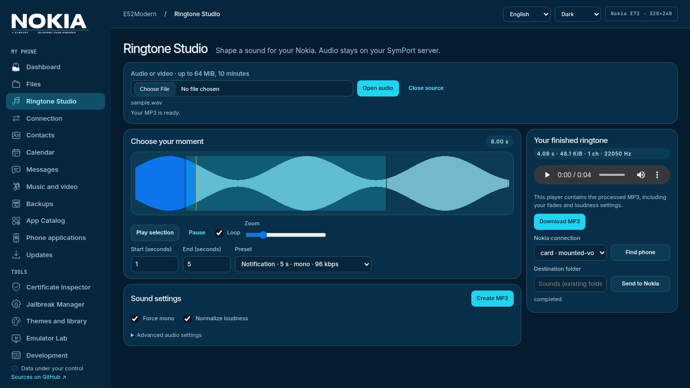
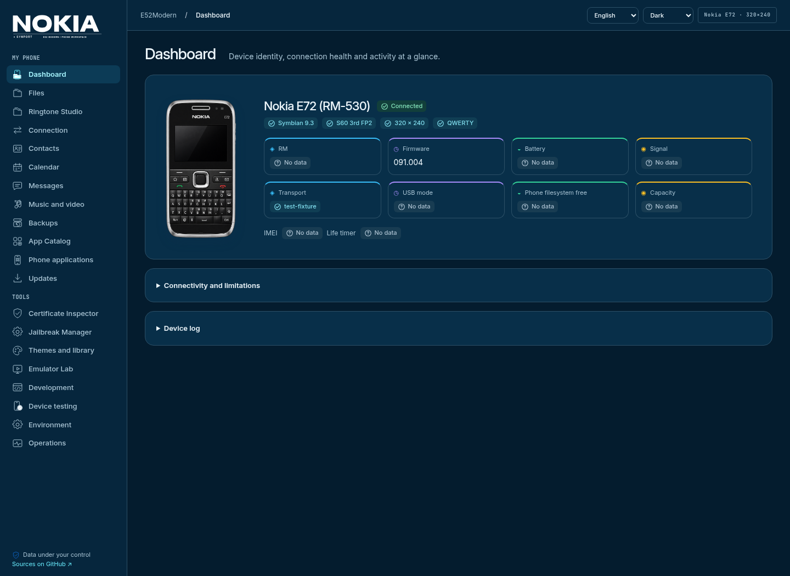

# SymPort

**Веб-пространство для Nokia E52 и E72:** телефон, файлы, контакты, музыка
и приложения — рядом с инструментами разработки для Symbian S60.
Интерфейс Nimbus: русский и английский, светлая и тёмная тема.



## Запуск в Docker

Нужны Docker Engine / Docker Desktop с Linux-контейнерами и Compose v2.

```bash
git clone https://github.com/grayhex/e52modern.git
cd e52modern
tools/install.sh
```

Windows PowerShell:

```powershell
git clone https://github.com/grayhex/e52modern.git
cd e52modern
.\tools\install.ps1
```

Откройте **http://127.0.0.1:8765**. Установщик проверяет конфигурацию,
создаёт `.env`, собирает образ и запускает SymPort. Другой порт задаётся
в `.env` через `SYMPORT_HTTP_PORT` до запуска.

Обновление: `git pull`, затем повторный запуск установщика. Настройки и данные
в именованных Docker volumes сохраняются. Не удаляйте volumes для обновления.
Проверка без запуска: `tools/install.sh --check` / `.\tools\install.ps1 -Check`.

[Установка, хранение данных и HTTPS](docs/DOCKER_DEPLOYMENT.md)

## Подключение телефона

1. [Скачайте Windows Bridge](https://github.com/grayhex/e52modern/actions/workflows/windows-bridge.yml):
   последняя успешная сборка → **SymPortBridge-Windows-x64**.
2. Распакуйте архив и запустите `SymPortBridge.exe`. Настройки и автозапуск — в трее.
3. В SymPort откройте **Подключение → Запросить доступ** и подтвердите адрес в Windows.
4. Подключите Nokia, выберите **PC Suite**, нажмите **Найти телефон**.

Агент подключается к серверу исходящим соединением: входящий порт на Windows
и ручной SSH-туннель для этого способа не нужны. Сборка Bridge пока неподписана;
USB-драйверы Nokia устанавливаются отдельно.

Для Linux доступны локальные транспорты и существующий PC Bridge. Карту памяти
можно явно подключить через `compose.phone.yaml`. **Mass Storage предоставляет
файлы карты, а не контакты, SMS или внутренний `C:/`.** Функции появляются только
при поддержке выбранным транспортом.

[Windows Bridge](docs/WINDOWS_BRIDGE.md) · [USB, Bluetooth и совместимость](docs/TRANSPORTS.md)

## Что можно делать

| Раздел | Возможности |
|---|---|
| Обзор телефона | Автоопределение E52/E72, изображение модели, прошивка/RM, батарея, сигнал, память, состояние служб и журнал. Недоступные показатели отмечаются значком; IMEI скрыт |
| Файлы | Просмотр доступных папок, скачивание/передача, создание каталогов и подтверждаемое удаление там, где транспорт это поддерживает |
| Медиа | Фото, видео и музыка: миниатюры, поиск, фильтры, предпросмотр, массовое скачивание ZIP |
| Мастер рингтонов | Waveform и перетаскивание фрагмента, точное время, loop/zoom, mono, LUFS, fade, битрейт/частота. MP3 для скачивания и передачи на Nokia |
| Контакты | Чтение, редактирование, дубли, Google CSV и Apple/Google vCard, экспорт и синхронизация с предпросмотром |
| SMS | Чтение, поиск, переписки, JSON/CSV и копии. Отправка — с подтверждением через проверенный профиль подключения |
| Календарь | События и задачи, iCalendar, безопасное создание/изменение и анализ конфликтов |
| Приложения и темы | Каталог, проверка SIS/SISX/JAR, передача пакетов, локальная библиотека тем и E52 CLEAR |
| Certificate Inspector | Сертификаты, подписи, UID, capabilities, зависимости и рекомендации по ошибкам установки |
| Emulator Lab | MGO/EKA2L1, пользовательская прошивка, управление сеансом, проверка пакетов/тем, снимки и отчёты |
| Разработка | CLI, профили E52 240×320 и E72 320×240, SDK, сборки и протокол испытаний |

Передача пакета не означает его установку: завершите её на экране Nokia.
Рингтон назначается в настройках телефона после передачи. Ringtone Studio
обрабатывает аудио локально в Docker, без внешних сервисов.



Снимок E72 использует явно заданный тестовый транспорт; иллюстрация телефона —
графический ресурс, а не подтверждение аппаратной совместимости.

## Основные сценарии

**Рингтон:** загрузите MP3/M4A/MP4 или нажмите «Создать рингтон» в медиагалерее →
выделите фрагмент → настройте звук → создайте и прослушайте готовый MP3 → скачайте
или передайте. [Форматы и ограничения](docs/RINGTONE_STUDIO.md).

**Контакты из облака:** выгрузите Google CSV / vCard или Apple vCard → загрузите
в «Контакты» → проверьте поля и дубли → посмотрите план синхронизации → подтвердите.
Если доступна только карта памяти, передайте vCard и сохраните их на телефоне.

**Резервная копия:** сохраните доступные данные до изменений. Прямая запись личных
данных требует актуального плана, копии исходного состояния и проверки чтением.
Полные файловые backup jobs работают с томами сервера; через Bridge доступны
копии выбранной папки и личных данных.

## Emulator Lab и обновления

Опциональный Lab: `tools/install.sh --emulator` или `.\tools\install.ps1 -Emulator`.
Загрузите собственную прошивку в Lab; ROM и ключи не входят в образ. Результаты
сохраняются в volumes. [Инструкция Lab](docs/EMULATOR_LAB.md).

**Запись прошивки физического телефона отключена.** Updates сравнивает версию
с локальным справочником E52/E72. USB Bridge не содержит проверенного прошивальщика
и процедуры восстановления. Загрузка прошивки в эмулятор — отдельный сценарий.

E72 использует экран 320×240 и QWERTY. Портретные ресурсы E52 CLEAR не становятся
ландшафтными автоматически; проверяйте темы под соответствующий экран.

## Данные и безопасность

По умолчанию Docker публикует только loopback-порт. Для удалённого доступа
используйте SSH либо HTTPS-прокси с аутентификацией. Управляющий API нельзя
открывать в интернет без защиты. Сообщения, контакты и IMEI не попадают в обычный
журнал. Опасные действия требуют подтверждения; неопределённые записи не повторяются.

Экспериментальный [Jailbreak Manager](docs/JAILBREAK_MANAGER.md) — отдельный
добровольный сценарий; обычная установка не отключает защиту телефона.

[Возможности транспортов](docs/TRANSPORTS.md) · [Личные данные](docs/DEVICE_WORKSPACE.md)
· [Архитектура](docs/ARCHITECTURE.md) · [Разработка](docs/DEVELOPMENT.md)

Код SymPort — MIT. Лицензии сторонних компонентов сохраняются; Windows-дистрибутив
с Gammu поставляется с GPL-3.0, соответствующими исходниками и уведомлениями.
