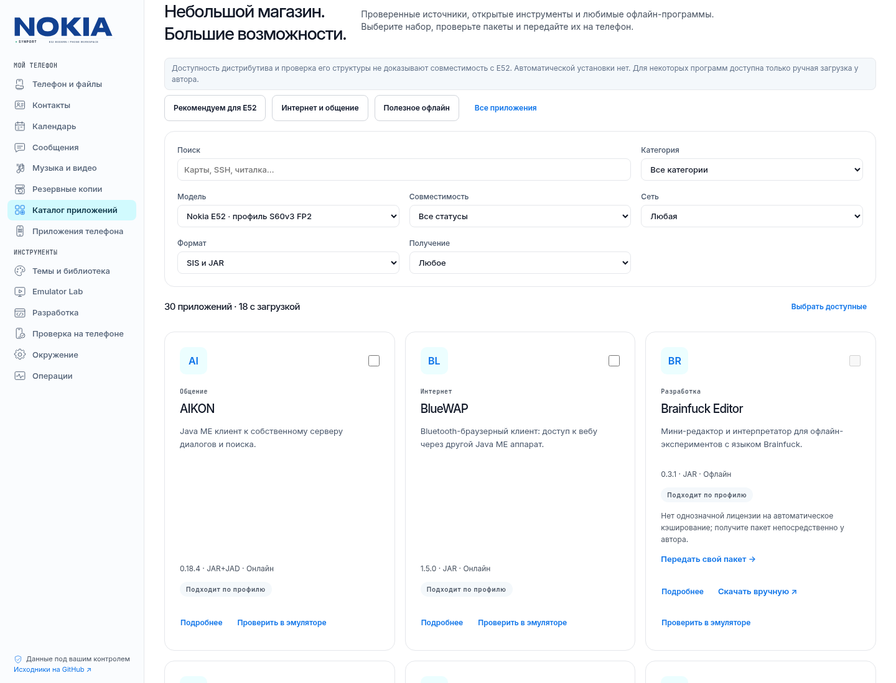
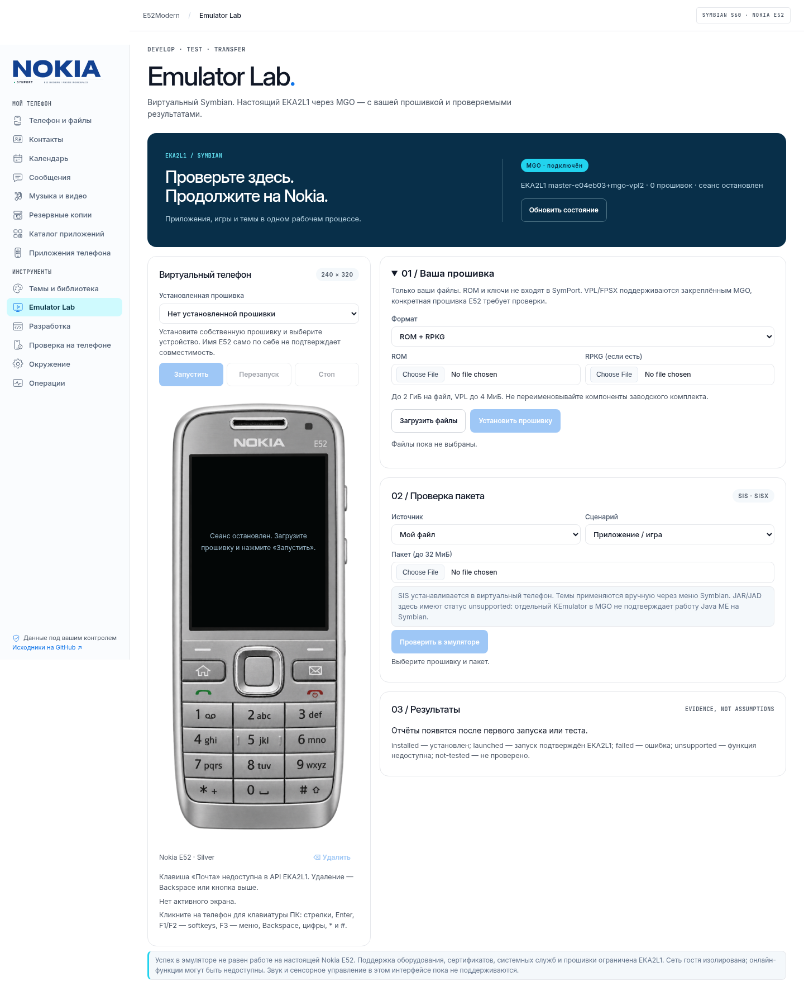
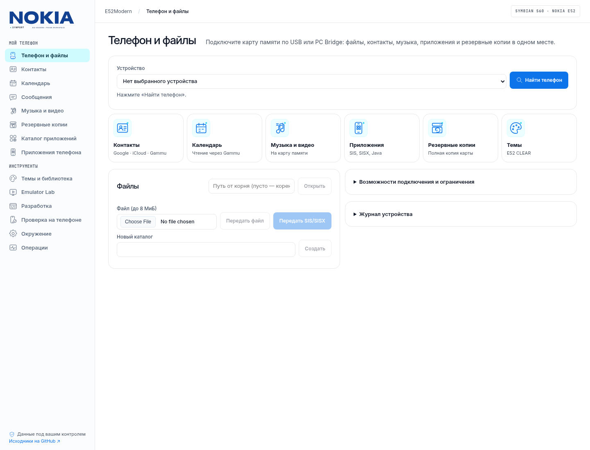

# E52Modern

**SymPort** — веб-среда для работы с телефонами Symbian S60. Подключите телефон,
управляйте доступными файлами, передавайте пакеты, сохраняйте резервные копии и
работайте с локальной библиотекой тем. Первый целевой телефон — **Nokia E52**
(Symbian 9.3 / S60 3rd Edition FP2).

Основной интерфейс — **SymPort Phone Workspace**. CLI, SDK и инструменты разработки
остаются частью проекта: они помогают создавать, проверять и упаковывать темы и приложения.
E52 CLEAR — встроенный проект темы Light/Dark, а не единственное назначение среды.

| Раздел | Сейчас |
|---|---|
| Телефон и файлы | Явно подключённые накопители, просмотр, загрузка, скачивание, каталоги, удаление с подтверждением |
| Подключение | Локальный накопитель, необязательный Gammu identify, PC Bridge через SSH |
| Контакты | Google CSV / Apple и Google vCard: просмотр, поиск, правки, выбор, экспорт; передача vCard или добавление через Gammu с проверкой чтением |
| Музыка и видео | Передача MP3/AAC/M4A/WAV/MIDI/AMR, MP4/3GP до 64 МиБ на файл, без перекодирования |
| SMS | Недоступны для текущих адаптеров; UI объясняет ограничение |
| Каталог приложений | 30 карточек из оригинальных источников: 18 с загрузкой, 12 с ручными ссылками; наборы, очередь, проверка и пакетная передача |
| Игры и приложения | Проверка и передача SIS/SISX/JAR/JAD до 32 МиБ; установка подтверждается на экране телефона |
| Резервные копии | Полная файловая копия карты в браузере: создание с прогрессом, проверка SHA-256, восстановление по плану без перезаписи, удаление; отдельно ZIP одного каталога |
| Календарь | Чтение событий и задач через Gammu (только чтение), поиск, экспорт `.ics`/JSON |
| Приложения на накопителе | Поиск SIS/SISX на карте: имя, UID, версия, подпись, CRC (реестр установленного недоступен) |
| Emulator Lab | Опциональный MGO/EKA2L1: пользовательская прошивка, экран и кнопки, SIS/темы, отчёты и передача проверенных байтов на Nokia |
| Интерфейс | Дизайн Nimbus, компактный макет: страницы рассчитаны на один экран, длинные списки прокручиваются внутри карточек |
| Темы | Загрузка SIS, отдельная публикация в локальной библиотеке, скачивание и передача |
| Разработка | Сборка E52 CLEAR, создание приложений, анализ SIS/E32, протокол испытаний |

**Аппаратная совместимость не подтверждена:** настоящая прошивка E52 и физический телефон ещё не тестировались. Проверены API настоящего EKA2L1 без ROM и успешный сценарий Lab с mock-агентом.
Передача SIS не означает установку; наличие файла не означает наличие приложения.
[Подключение телефона и PC Bridge](docs/DEVICE_MANAGER.md) · [Архитектура](docs/ARCHITECTURE.md).

## App Catalog

Откройте **«Каталог приложений»**: поиск, категории, профиль E52, сеть, формат и
готовые подборки. Отметьте программы → проверьте зависимости → скачайте и проверьте
набор → выберите подключённый телефон и папку → подтвердите передачу. Набор можно
сохранить. Установка выполняется на Nokia и фиксируется отдельно пользователем.

В каталоге 30 исследованных позиций: **18 автоматических и 12 ручных**. Ручные
карточки ведут к автору и в общий раздел передачи пакетов; они не выдаются за
доступные для автоматического скачивания. Онлайн-сервисы, лицензии, TLS, подписи и
необходимые backend описаны в подробностях. **Проверенных на E52 приложений пока 0.**
[Подробности, источники и ограничения](docs/APP_CATALOG.md).



## Emulator Lab

```bash
docker compose --profile emulator up -d --build
# Через localhost / SSH: http://127.0.0.1:8765/#lab
```

Загрузите свою ROM/RPKG, архив или исходный VPL/FPSX → установите прошивку →
выберите устройство → запустите сеанс. Экран 240×320 получает реальные PNG из
EKA2L1; аппаратные кнопки и клавиатура ПК передают ввод через существующий агент MGO.
**Проверить в эмуляторе** в каталоге, библиотеке и сборках выбирает пакет для
подтверждённой установки. Тема применяется вручную через системное меню, её UID
не запускается. Отчёт сохраняет SHA-256, прошивку, установку/запуск, снимки и логи;
затем тот же пакет можно передать через Device Manager на физическую Nokia.

Используется закреплённый готовый `mgo-symbian`, без копирования кода MGO и без ROM
в Git/образе. Прошивки, saves и результаты хранятся в постоянных томах. У агента
нет опубликованных портов. JAR/JAD получают `unsupported`: отдельный KEmulator
не подтверждает работу Java ME на Symbian. Доступность меню и применения тем
зависит от EKA2L1/прошивки; успех эмулятора не подтверждает работу на настоящей E52.
[Подключение, сценарии, статусы, защита и ограничения](docs/EMULATOR_LAB.md).



[Lab на мобильном](docs/screenshots/emulator-lab-mobile.png) ·
[Проверки и ограничения](docs/EMULATOR_LAB.md#проверено-3-ноября-2026).

## Контакты, музыка и ПО

**Контакты:** выгрузите Google CSV/vCard из Google Contacts или vCard из iCloud/Apple
Contacts → откройте «Контакты» → проверьте файл → выберите записи и устройство →
подтвердите перенос. Для накопителя передаются отдельные VCF, которые нужно открыть
на Nokia. Gammu добавляет записи и проверяет их чтением обратно, если транспорт
поддерживает телефонную книгу. [Полная инструкция и ограничения](docs/CONTACTS.md).

**Мелодии и видео:** «Музыка и видео» → устройство, существующая папка, файлы →
подтвердить передачу. Мелодия назначается в настройках телефона. Расширение файла
не гарантирует совместимость кодека; перекодирования нет.

**Игры и ПО:** «Приложения телефона» → SIS/SISX или Java JAR/JAD → проверить и передать →
открыть пакет на Nokia и завершить установку. Передача не означает установку.
Не обходятся проверки подписи, сертификата, разрешений или совместимости Symbian.

## Интерфейс

Дизайн по приложенному Nimbus reference: белый фон, тёмные поверхности `#082F49`,
голубой `#22D3EE`, синий `#0E74E9`, локальные Inter и JetBrains Mono. Компактная
навигация, адаптивные карточки, явные недоступные состояния и сценарии работы
с телефоном сохранены. Сервисы шрифтов и демонстрационные устройства не используются. Логотипы и 18
векторных иконок из предоставленного `nokia-symport-assets.zip` встроены в навигацию,
карточки и действия; палитра иконок адаптирована к Nimbus. Это независимый проект,
не официальный сервис Nokia. В Lab — подробный серебристый корпус E52 с рабочими
зонами клавиш и настоящим framebuffer поверх дисплея.



[Контакты — desktop](docs/screenshots/contacts-desktop.png) ·
[Контакты — mobile](docs/screenshots/contacts-mobile.png) ·
[Музыка и видео](docs/screenshots/media-desktop.png) ·
[Резервные копии](docs/screenshots/backups-desktop.png) ·
[Календарь](docs/screenshots/calendar-desktop.png) ·
[Темы](docs/screenshots/themes-desktop.png).
Скриншоты сняты в Chromium; телефон не подключён, тестовые данные не выдаются за его содержимое.
[Проверка соответствия дизайну](docs/UI_DESIGN.md).

## Быстрый старт

```bash
python3 -m venv .venv && . .venv/bin/activate && pip install -e '.[dev]'
python -m symport.web             # основной веб-интерфейс, только localhost / SSH
# Дополнительные средства разработки:
tools/s60/build.sh                 # собрать skc и bmconv из вендорных исходников (нужен g++)
symport doctor                     # окружение и backend'ы
symport theme build                # обе темы (то же, что python3 tools/build_theme.py)
symport theme inspect              # структура SKN/MBM/MIF, PKG, UID, палитра, манифест
symport theme package --variant light --backend native    # экспериментальный неподписанный SIS
```

Старые команды работают без изменений: `tools/s60/build.sh`, `python3 tools/build_theme.py`.
`python -m symport` и команда `symport` эквивалентны.

## Браузерная панель (Docker / Linux / WSL2)

SymPort Phone Workspace объединяет контакты, файлы, мелодии, видео и пакеты ПО. Разделы разработки, тем и ручного протокола E52 доступны в том же интерфейсе.

```bash
# Linux-сервер; слушает только loopback
 docker compose up -d --build
# На Windows: ssh -L 8765:127.0.0.1:8765 user@your-server
# Открыть: http://127.0.0.1:8765
```

Без Docker: `python -m symport.web --open` (после установки зависимостей и компиляторов).

См. [документацию Workbench](docs/WEB_UI.md). Сборка в Docker не содержит официальный MakeSIS или native GUI SDK по умолчанию; экспериментальный SIS не проверен на E52. USB на Windows не виден удалённому серверу автоматически.

## Команды

| Группа | Команды |
|---|---|
| Окружение | `doctor`, `profile list/show` |
| Тема (P0) | `theme build`, `theme inspect [--reproducible]`, `theme package [--backend auto\|makesis\|native\|modern-sdk]` |
| Анализ | `sis inspect`, `sis compare`, `app inspect`, `app analyze [--firmware-profile] [--cross-check]` |
| Приложения (P1) | `app init`, `app build [--mode app\|toolchain]`, `app package` (через `symbian-platform`) |
| Телефон (том, Gammu) | `phone backup create\|verify\|restore`, `phone apps inventory`, `phone stage`, `phone calendar read` |
| Тестирование (P2) | `emulator list/test`, `device list/info/stage`, `report matrix` |

Каждая команда поддерживает `--json` и `--report FILE`. Коды возврата: 0 успех, 1 ошибка проверки, 2 ошибка использования,
3 операция недоступна (нет инструмента).

## Документация

[Архитектура](docs/ARCHITECTURE.md) · [Установка Linux/WSL2](docs/INSTALL.md) · [Внешние инструменты (аудит)](docs/EXTERNAL_TOOLS.md) ·
[Сборка темы](docs/THEME.md) · [Упаковка и подпись SIS](docs/PACKAGING.md) · [Первое приложение](docs/APPLICATIONS.md) ·
[Бинарная совместимость](docs/COMPATIBILITY.md) · [Emulator Lab](docs/EMULATOR_LAB.md) · [CLI эмулятора](docs/EMULATOR.md) · [Тест на E52](docs/DEVICE_TEST.md) ·
[Дорожная карта](docs/ROADMAP.md) · [Резервная копия и файлы](docs/PHONE_BACKUP.md) · [Статусы](docs/STATUS.md) · [Ограничения](docs/LIMITATIONS.md)

## Device Manager

Workbench включает файловый Device Manager: зарегистрированные накопители, Gammu identify, передача SIS, журнал и файловый ZIP backup/restore с предпросмотром. Для удалённого ПК предусмотрен PC Bridge через SSH. См. [подключение и ограничения](docs/DEVICE_MANAGER.md). Аппаратная совместимость с E52 не подтверждена.

## Тесты и CI

```bash
pytest            # без телефона и без проприетарного SDK
ruff check .
```

CI (`.github/workflows/ci.yml`): стиль, тесты на Python 3.11–3.13, сборка `skc`/`bmconv`, пересборка обеих тем,
проверка выходных файлов, воспроизводимость, JSON-отчёты и экспериментальный SIS как артефакты. Чужие ROM, прошивки,
закрытые SDK и приватные ключи в CI не используются.

## Лицензии

Код SymPort — MIT (см. `pyproject.toml`). Вендорные исходники Nokia/Symbian Foundation — EPL-1.0
(`tools/s60/vendor/NOTICE.md`). Внешние программы (symbian-platform — Apache-2.0, EKA2L1 — GPL-3.0) не входят в репозиторий.
