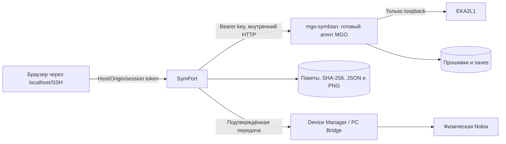

# Архитектура SymPort Phone Workspace

SymPort — прежде всего веб-среда работы с телефоном Symbian. Пользовательский маршрут:
подключение → доступные данные телефона → файлы/копии/пакеты. Контакты и SMS доступны
только при наличии транспорта, который действительно предоставляет эти возможности.
Разработка приложений и тем, локальная публикация и скачивание — вспомогательные разделы.

Код разделён по назначению:

* `symport/phone/contracts.py` — контракт транспортов и лимиты;
* `symport/phone/files.py` — доступ к зарегистрированному накопителю и файловые копии;
* `symport/phone/local.py` — локальные источники, включая Gammu identify;
* `symport/phone/bridge.py` — авторизованный PC Bridge через локальный SSH-туннель;
* `symport/phone/contacts.py` — Google CSV / vCard, нормализация, выбор и безопасный экспорт;
* `symport/phone/gammu_contacts.py` — чтение книги, добавление без удаления и проверка чтением обратно;
* `symport/phone/service.py` — диспетчер операций и журнал без содержимого данных;
* `catalog/`, `symport/catalog/` — курируемые метаданные и одобренные источники, безопасный downloader, зависимости, очередь и пакетная передача;
* `symport/inspector/` — ограниченный разбор X.509/SIS-подписей, статическая диагностика и подтверждённая передача тех же байтов;
* `symport/jailbreak/` — fail-closed мастер: ZIP-инвентарь без ключей, dry-run/копия/staging, ручные свидетельства и hash-checked частичный откат;
* `symport/web_assets/preferences.js`, `translations.json`, `preferences.css` — локальные RU/EN и Nimbus Dark;
* `symport/lab/client.py` — ограниченный внутренний HTTP-клиент существующего агента MGO, bearer key из общего тома;
* `symport/lab/service.py` — потоковая загрузка прошивки, оркестрация SIS/тем, постоянные отчёты и передача тех же байтов через Device Manager;
* `symport/library.py` — проверка, импорт, явная локальная публикация и выдача SIS;
* `symport/web.py`, `symport/web_assets/` — HTTP API и веб-интерфейс;
* `symport/theme`, `application`, `analysis`, `backends` — средства разработки;
* `symport/devices` — существующие CLI-профили и интеграция symbian-platform.

Тема проходит состояния «импортирована» → «опубликована локально»; передача на телефон
является отдельной операцией. Статус установки вводится после реальной проверки.
Публичного каталога или автоматической публикации в GitHub нет.

SymPort — Python-пакет `symport` внутри репозитория E52Modern. Он **не заменяет** существующие
инструменты (`tools/build_theme.py`, `tools/s60/*`), а вызывает их как внешние backend-процессы:
прямой запуск старых команд работает по-прежнему.

```
symport/
  cli.py            argparse CLI: python -m symport / symport
  config.py         поиск репозитория, symport.toml, переменные окружения
  report.py         JSON-отчёты: проверки с уровнем доказательства (static/environment/firmware/emulator/device)
  doctor.py         обзор окружения; необязательные компоненты не блокируют чужие операции
  backends/
    nokia_skin.py   tools/build_theme.py, tools/s60/{build.sh,s60inspect.py}
    packaging.py    makesis/signsis (официальные), native (экспериментальный), modern-sdk
    modern_sdk.py   CLI `symbian` из symbian-platform (Apache-2.0)
    legacy_sdk.py   обнаружение оригинального Symbian/Carbide SDK (EPOCROOT)
    eka2l1.py       поиск эмулятора
  theme/            pkg-парсер, UID, inspect, package, reproduce
  sis/              собственные читатель и писатель SIS 9.x (fields, reader, writer)
  analysis/         E32 (заголовок, импорты, capabilities), оценка совместимости
  application/      workflow (init/build/package/inspect), analyze
  devices/          профили устройств, device stage
  emulator.py       запуск внешнего эмулятора в изолированной сессии
  reports/          матрица совместимости
profiles/           декларативные профили устройств (nokia-e52.toml)
tests/              pytest (без телефона и без проприетарного SDK)
```

## Принципы

* **Reuse first.** Компиляция скинов — оригинальный Nokia Skin Data Compiler; `.mbm` — оригинальный
  Symbian `bmconv`; низкоуровневая проверка `.skn/.mbm/.mif` — существующий `tools/s60/s60inspect.py`
  (импортируется, а не дублируется). SDK приложений, подпись приложений, передача на телефон —
  `symbian-platform`. Эмулятор — EKA2L1. Собственный код написан только там, где надёжной замены нет:
  SIS-писатель для произвольных файлов (экспериментальный), SIS/E32-читатели, адаптеры.
* **Честные уровни доказательства.** Каждая проверка в отчёте несёт `level`. Статическая корректность
  файлов никогда не превращается в утверждение о работе на прошивке или на телефоне. Блок
  `verification` в отчёте по умолчанию: `static_automated`, `emulator: not-tested`,
  `physical_device: not-tested`.
* **Отсутствие инструмента — это диагностика, а не заглушка.** Если backend недоступен, команда
  завершается кодом 3 со статусом `unsupported` и инструкцией; фиктивный SIS не создаётся.
  `auto` не переключается молча на экспериментальный писатель.

## Коды возврата

| Код | Значение |
|---|---|
| 0 | успех |
| 1 | проверка не пройдена / операция не удалась |
| 2 | ошибка использования (нет репозитория, неизвестный профиль, ...) |
| 3 | операция не поддерживается в текущем окружении (нет инструмента) |

## Формат отчёта (`symport.report/1`)

```json
{"schema": "symport.report/1", "command": "...", "status": "ok|failed|unsupported",
 "verification": {"static_automated": true, "emulator": "not-tested", "physical_device": "not-tested"},
 "checks": [{"id": "...", "status": "pass|fail|warn|skip|unknown", "level": "static|environment|firmware|emulator|device",
             "message": "...", "evidence": {}}],
 "artifacts": [{"path": "...", "size": 0, "sha256": "..."}], "limitations": ["..."], "data": {}}
```

## Конфигурация

Необязательный `symport.toml` в корне репозитория (в `.gitignore`, секретов в репозитории не хранить):

```toml
[packaging]
backend = "auto"                 # auto | makesis | native | modern-sdk
makesis = ["wine", "/path/makesis.exe"]   # строка или список; либо SYMPORT_MAKESIS
signsis = "/path/signsis"

[emulator]
command = ["/path/eka2l1", "...", "{sis}"]     # {sis} {workdir} {log}
data_root = "/path/prepared/data"
timeout = 120
success_marker = "regex"
```

Переменные окружения: `SYMPORT_REPO`, `SYMPORT_PROFILES`, `SYMPORT_MAKESIS`, `SYMPORT_SIGNSIS`,
`SYMPORT_SIGN_PASSPHRASE`, `SYMPORT_SYMBIAN`, `SYMPORT_EKA2L1`.

## Emulator Lab / MGO



Профиль Compose `emulator` добавляет закреплённый образ MGO в `internal` сеть без
опубликованных портов. Firmware/test jobs выполняются асинхронно; одновременно
разрешена одна операция. Ошибка/restart не повторяет опасные операции автоматически.
Установка SIS и запуск приложения фиксируются раздельно; UID темы не запускается.
Наблюдения о применении темы вводятся пользователем и сопровождаются снимком.
Java остаётся `unsupported`, без подмены ядром KEmulator. API не принимает
произвольный URL агента, маршрут control API или путь файла сервера от браузера.
[Контракт, хранение, проверка и ограничения](EMULATOR_LAB.md).

Математика подписи не подменяет доверие телефона. Системные операции Jailbreak Manager
не входят в транспортный allow-list; generic install/patch/system-write блокируются
даже при подтверждении клиента. Откат ограничен собственными файлами с совпавшим SHA-256.
