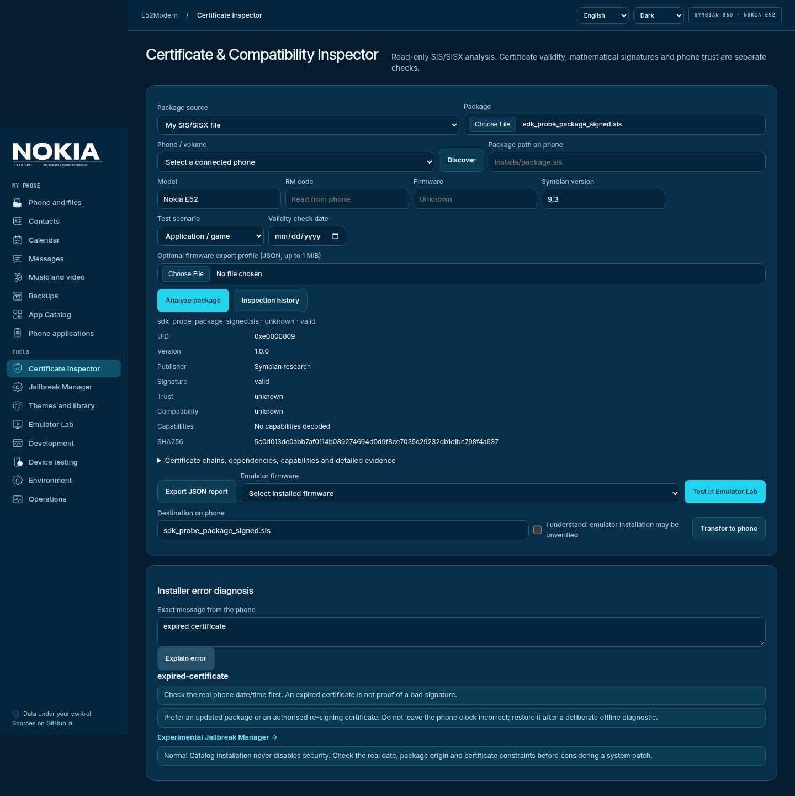

# Certificate & Compatibility Inspector

Inspector is a read-only analysis screen shared by Catalog, Device Manager, theme/build
library and Emulator Lab. Upload SIS/SISX, choose a build/catalogue entry or a file from
an enrolled phone volume. The package is identified by SHA-256; later emulator tests and
phone transfers use those exact saved bytes, with an integrity check before each hand-off.

## What is checked

- SIS UID/header identity, package UID/name/vendor/version, available CRC and payload hashes.
  Optional CRC fields may be absent: the report records `null` (not checked), never `true`.
- Certificate subject/issuer/serial/fingerprint, validity at the selected UTC date and
  certificate extension OIDs. No private signing key is accepted or needed.
- SIS controller mathematical signatures: RSA/SHA-1, RSA/SHA-256, DSA/SHA-1. Signed bytes
  are the controller payload preceding each signature-chain field. Issuer links and
  present self-signed roots are mathematically checked; unfamiliar algorithms remain unsupported.
- Requested capabilities and restrictions from available E32 headers; dependency UIDs
  and version ranges, including target-device prerequisites.
- Existing E32 compatibility evaluator and E52 profile: CPU/kernel/ABI/header/imports.
  An optional user-supplied firmware export JSON must match the selected model and exact
  firmware version. See [firmware-profile.md](firmware-profile.md).

`valid` signature mathematics, `valid` certificate dates, trusted phone certificate store,
capability/IMEI/SID/VID constraints and successful installation are **different facts**.
Phone trust, revocation, device bindings and certificate capability authorisation are
not established here. An embedded valid public certificate is not automatically trusted.
SHA-1 is explicitly labelled legacy. Publisher text in SIS is not an authenticated identity.

Conditional/embedded controllers and multi-data-unit packages are only partially decoded;
missing capabilities/imports must not be interpreted as absence. E52 profile hardware
facts have their existing evidence levels; other models remain unknown. Static compatibility
never establishes installation or runtime success. Dependencies are listed, not assumed installed.

## Workflow

1. Open **Certificate Inspector** from a Catalog card, device SIS file, build, theme or
   Lab report, or upload your own file. Record model/RM/firmware, validity check date and
   optional exact firmware export profile.
2. Analyze. Review issues, certificate chains, capabilities and raw evidence. Export JSON
   `symport.inspector/1` for a durable report. Data stays in `build/symport/inspector` (0700).
3. Enter the exact phone installer error for heuristic diagnosis: expiration, certificate,
   capabilities, dependencies or OS compatibility. The source of the diagnosis is labelled.
4. Choose installed MGO firmware and confirm a test in Emulator Lab. Themes retain the
   separate manual-application workflow; they are not launched by package UID.
5. Transfer the inspected package with confirmation. Without a successful emulator install,
   explicitly acknowledge that it is unverified. Transfer is not installation on Nokia.

## Recommendations and limits

Check the **real** clock first; do not leave it wrong or change it automatically. Old
certificate-date workarounds can affect TLS/network services and may be overridden by
network time. Prefer an updated publisher package or authorised signing identity.
App Manager → Software installation → All is a user setting, not a grant of restricted
capabilities. The Inspector does not silently modify it or turn off security.

Use your own authorised signing tools/certificate outside the web server; existing
MakeSIS/SignSIS backends remain available. The shared key in the provided archives is
excluded from imports and never used. There is no automatic re-signing service with
shared or uploaded private keys.

Restricted capabilities may require an appropriately authorised certificate/policy;
a signature cannot make an incompatible CPU/OS/API dependency compatible. Only open
[Experimental Jailbreak Manager](JAILBREAK_MANAGER.md) deliberately after reviewing
these facts. Normal Catalog operations never enable patches.

## Validation

Tests independently verify the real SDK signed fixture, expiration separated from signature
mathematics, tampering with recomputed valid CRC, omitted CRC, wrong firmware profile,
confirmation gates, unchanged bytes and HTTP authentication. Browser checks exercise the
real certificate UI and diagnosis. No successful install on a physical E52 is claimed.

Validation on 2026-11-03: 246 tests, browser workflows and Docker HTTP inspection
of the independent signed SDK fixture. [Docker evidence](validation/security-docker.json).
