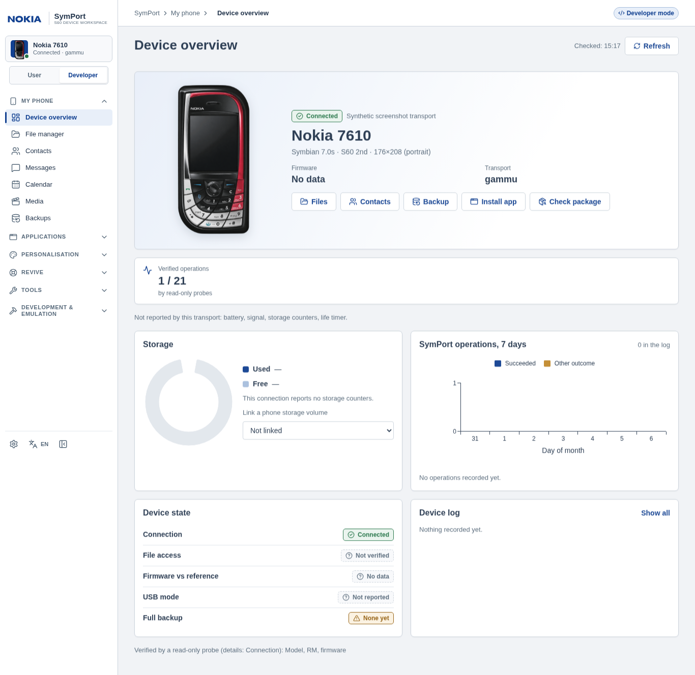

# Nokia 7610 (S60 2nd Edition)

**Оригинальная Nokia 7610 (2004), Symbian OS 7.0s / Series 60 2nd Edition.** Это не Series 40-модель
**7610 Supernova**: имя «7610 Supernova» намеренно не распознаётся как эта модель (поле реестра `not_aliases`).
7610 — первая цель SymPort с платформой **S60 2nd Edition**, которая старше всех остальных (3rd, 5th, Symbian^3):
другая версия ОС, экран 176×208 и, скорее всего, другое ядро и формат установочных пакетов. Поэтому правила
S60 3rd/5th и Symbian 9.x на неё **не переносятся**.

## Что известно о модели (документация, не измерения)

| Факт | Значение | Статус |
|---|---|---|
| ОС / платформа | Symbian OS 7.0s, S60 2nd Edition (в источнике — UI S60 v2.1) | documented |
| Экран | 176×208, портретный | documented |
| Управление | Кнопки, несимметричная раскладка клавиш; сенсора нет | documented |
| Память | 8 МБ внутренняя, съёмная карта RS-MMC | documented |
| Связь | Bluetooth 1.1, USB через разъём Pop-Port | documented |
| Процессор | ARM4T, 123 МГц | documented |
| Ядро, формат SIS | EKA1 и «старый» SIS (до Symbian 9.1) | inferred (из версии ОС) |
| RM / product code, прошивка, версия ПО, смонтированный том, свободное место, права записи, службы | — | **unknown** до ответа адаптера |

Источники: [Wikipedia](https://en.wikipedia.org/wiki/Nokia_7610), [GSMArena](https://www.gsmarena.com/nokia_7610-703.php).
Профиль — `profiles/nokia-7610.toml` (у каждого факта есть источник и статус), запись реестра — `nokia-7610` в
`symport/phone/device_models.json`. Идентификация по имени даёт `identity_basis: reported-model`,
`source: documented-model-profile`, `measured: false`, `hardware: not-tested`. Код модели (RM/RH) не
подставляется: он принимается только из ответа телефона. RM другой зарегистрированной модели вместе с именем
7610 — конфликт, а не подтверждение.

## Что SymPort делает для 7610

SymPort не добавляет 7610 собственных возможностей: **всё, что доступно, определяет транспорт и проверочное
чтение**; модель даёт имя, картинку, платформу и геометрию экрана.

| Раздел | Поведение |
|---|---|
| Обзор | Модель, «Symbian 7.0s · S60 2nd · 176×208», транспорт, состояние подключения. Заряд, сигнал, счётчики накопителя, прошивка показываются, только если их вернул транспорт; иначе «Нет данных» / «Не сообщается», никаких нулей |
| Файлы, медиа | Только если есть реальный смонтированный том или OBEX FTP: список, скачивание, загрузка новых файлов с подтверждением. Системные и приватные папки (`sys`, `private`, `resource`, `system`) защищены. OBEX OPP — только передача: просмотра и скачивания нет |
| Контакты, SMS, календарь | Включаются отдельно для каждого хранилища после подтверждённого чтения. Если хранилище не проверено или не поддерживается, страница так и говорит; пустой список вместо отказа не показывается |
| Резервные копии | Копируются файлы доступного тома и прочитанные хранилища. Это не «полная копия телефона» |
| Приложения | Передача SIS/JAR возможна, только если транспорт позволяет записывать файлы. **Передача не установка**: установку подтверждает пользователь на телефоне. Список установленных программ не придумывается |
| Проверка пакетов (Inspector, зависимости, каталог) | Результат для 7610 никогда не «совместимо»: у SymPort нет проверенных правил для S60 2nd Edition. Итог не лучше `unknown` / `unresolved` / `not-tested`; пакеты S60 3rd/5th, объявляющие свою платформу, отмечаются как заведомо другие. Старый формат SIS не разбирается |
| Восстановление | Мастера рассчитаны на S60 3rd Edition и новее: проверка платформы возвращает «Не поддерживается» |
| Темы | Не поддерживаются (отдельная задача); модель видна в списке, редактор отказывает с причиной |
| Прошивка, jailbreak | Вне задачи, не реализованы |

## Транспорты

| Подключение | Что подтверждается |
|---|---|
| Смонтированный том (RS-MMC в кардридере; USB-режим, если телефон/драйвер его предоставляют) | Только файлы тома. USB-кабель Pop-Port сам по себе не гарантирует тома; не смонтирован — файловые функции недоступны |
| Bluetooth OBEX FTP | Просмотр списка; скачивание и запись остаются непроверенными, пока не подтверждены. Контактов и SMS нет |
| Bluetooth OBEX OPP | Только передача (push): ни списка, ни скачивания, ни чтения хранилищ |
| Gammu | Идентичность модели (`identity.read`) не включает PIM: контакты, SMS, календарь доступны только после проверочного чтения именно этого хранилища. Подключение описывается в `gammurc` администратором |
| Gnapplet | Приложение проекта Gammu для телефонов Series 60. Если для PIM нужен апплет, это отражается как статус возможности, а не включается по факту ответа на identity. Работа Gnapplet именно на 7610 в SymPort не проверялась и не требуется |

Профиль подключения (`connections.json`) допускает `edition: "2nd"` наряду с `3rd`, `5th` и `symbian3`.
Кандидат хоста ≠ идентичность телефона ≠ поддерживаемый транспорт.

## Известные ограничения

* Формат SIS до Symbian 9.1 и бинарники EKA1 не анализируются: результат `unknown`.
* Нет проверенных платформенных UID S60 2nd Edition: ни один не поставляется и не заимствуется у 3rd/5th.
* Телефонные проверки: `hardware: not-tested`. Автоматические тесты используют тестовые транспорты.
* Иллюстрация восстановлена по фото чёрно-красной модели: асимметричный корпус и диагональная клавиатура. Это декоративная графика, не живой экран телефона.

## Чек-лист проверки на телефоне

Результаты фиксируются отдельно в [отчёте проверки](DEVICE_TEST.md); без прохождения они остаются `not-tested`.

- [ ] Имя модели читается как `7610` (не «Supernova»), SymPort показывает «Nokia 7610 · Symbian 7.0s · S60 2nd».
- [ ] Заряд/сигнал/прошивка либо показываются (если их вернул транспорт), либо честно «Нет данных».
- [ ] Bluetooth OBEX FTP: список папок; затем скачивание небольшого файла; запись нового файла и обратное чтение.
- [ ] Bluetooth OBEX OPP: передача файла; убедиться, что просмотр и скачивание недоступны.
- [ ] Карта RS-MMC в кардридере: том виден, списки и подтверждаемая запись работают, `sys`/`private` блокируются.
- [ ] Gammu (AT/Bluetooth/кабель): идентичность читается; контакты/SMS/календарь включаются только после проверочного чтения; при отсутствии поддержки — «не поддерживается», а не пустой список.
- [ ] Gnapplet (если установлен): какие хранилища реально отвечают.
- [ ] Передача SIS: файл появляется на телефоне, установка подтверждена на экране вручную (формат SIS должен быть старым — Symbian 9.x-пакет на 7.0s не установится).
- [ ] Inspector для любого пакета остаётся `unknown`, в отчёте нет «совместимо».

## Графика

`symport/web_assets/phones/nokia-7610.svg` — самостоятельный мастер со встроенным заменяемым
фотореалистичным слоем корпуса, редактируемой областью отсечения и направляющей LCD.
`nokia-7610.png` и `nokia-7610.webp` — прозрачные экспорты; интерфейс использует WebP.
Графика повторяет предоставленное пользователем фото оригинальной чёрно-красной 7610:
изогнутую красную вставку, хромированную левую кромку и асимметричные диагональные клавиши.
Это иллюстрация по фотореференсу, а не поставляемая Nokia фотография или живой экран.
Форма и пропорции сохранены без растягивания; экран остаётся выключенным.
[Происхождение и экспорт](../symport/web_assets/phones/7610-ARTWORK.md).

