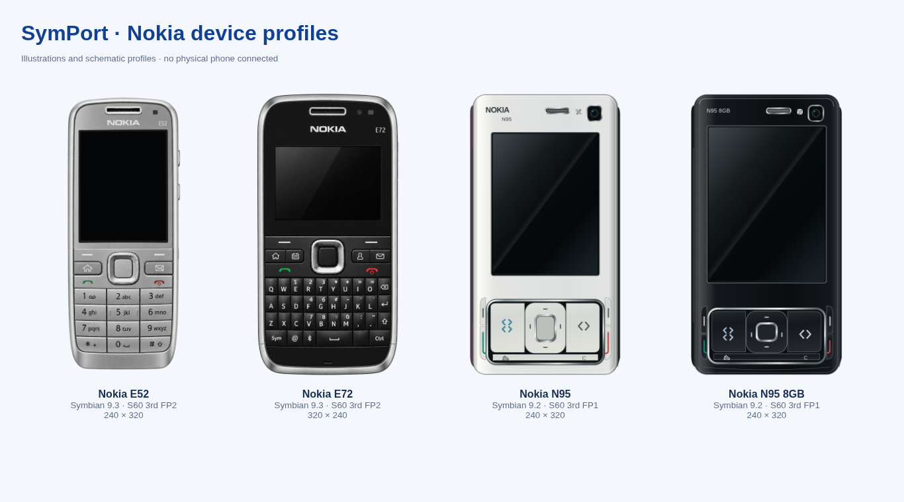

# Nokia N95 / N95 8GB

SymPort distinguishes two FP1 profiles. Model facts describe the handset; they never enable a
transport, register a disk, supply a memory counter or prove an installation.

| Profile | Default display | Platform | Storage design |
|---|---|---|---|
| `nokia-n95` | 240×320 portrait, 2.6″ | Symbian 9.2 / S60 3rd FP1 / EKA2 | Removable microSD; enrollment requires an observed volume |
| `nokia-n95-8gb` | 240×320 portrait, 2.8″ | Symbian 9.2 / S60 3rd FP1 / EKA2 | Built-in 8 GB mass memory; never assumed mounted |

Both bodies are approximately 99×53×21 mm closed. RAM/battery capacities differ by regional
variant: they are deliberately absent from live telemetry. Rotation is controlled by the
application/firmware; these are default portrait theme previews, not a virtual N95 emulator.

## Identification and sources

| Reported name | RM | Variant |
|---|---|---|
| N95-1 | RM-159 | Original |
| N95-3 / N95 NAM | RM-160 | Original, North America |
| N95-5 / N95 China | RM-245 | Original, China |
| N95-2 / N95 8GB | RM-320 | 8GB |
| N95-4 | RM-421 | 8GB, North America |
| N95-6 | RM-321 | 8GB, China |

Source: [Nokia N95 specifications and regional variants](https://en.wikipedia.org/wiki/Nokia_N95#Variations),
reviewed 2026-11-05. These names/RMs are documented references, not measured firmware profiles.
There is no verified product-code database in this change. Observed product codes are preserved by
the adapter, but an unrecognised code does not choose a variant. Conflicting model/RM evidence and
plain `N95` show **N95 (variant unknown)** / **N95 (модификация не определена)** with a neutral
illustration. Read the suffix/RM in device information before choosing an exact package target.

The shared source of truth is `symport/phone/model_registry.json` (Python and React). TOML files
retain `{value, status, source}` for every fact. Presentation facts are marked `measured: false`.
A documented FP1 platform does not prove the currently installed firmware/S60 version.

## Packages and themes

FP1 accepts the documented FP1 product UID `0x102032BE`; an earlier S60 3rd product UID
`0x101F7961` is an inferred static candidate. FP2 `0x102752AE`, 5th and later requirements are
rejected for these profiles. Unknown product UIDs or nonzero product-version constraints remain
unknown without matching inventory. A user-selected OS conflicting with the model is blocked.
Native CPU/kernel, dependency, capability and certificate checks continue in Inspector. An exact
user-supplied firmware profile must match the model and firmware version; ROMs/keys are not shipped.

Catalog responses now contain `model_compatibility` and `platform_compatibility`. Existing
`compatibility`, `e52_evidence` and all original metadata remain intact. E52 results never become
N95 results. New verified model evidence requires a source and exact package SHA-256. Catalog
batches analyse the downloaded SIS against the chosen target before any transfer; known blocked
packages fail. Unknown requirements stay visible, and file transfer never means installation.

Collections pin package versions/hashes and offer both targets. Review a new recovery plan when
switching from FP2. The unchanged transport capability matrix and confirmation gates still apply.

The existing Nokia `skc`/`bmconv` resource pipeline can produce and parse back a 240×320 resource
SIS with an FP1 prerequisite. Generated MBM/MIF/SKN, package checksums and payload equality are
checked. Imported FP2/product/version constraints that cannot be preserved block repacking.
**This proves resource/package structure, not firmware acceptance or visual correctness on N95.**
Firmware skin resources, fonts and actual menus need device testing. Themes are applied via the
system Themes menu, never launched as applications by UID. See [THEME.md](THEME.md).

## Original artwork

Separate editable SVG masters, PNG and lossless WebP exports are in
`symport/web_assets/phones/`. Their front plates, screen sizes, materials and key assemblies differ;
8GB is not a recolor. Blank screens contain no connection claim. See
[N95 artwork provenance](../symport/web_assets/phones/N95-ARTWORK.md).

Responsive review images: [N95 390px](screenshots/n95/nokia-n95-390.png),
[N95 768px](screenshots/n95/nokia-n95-768.png), [N95 1366px](screenshots/n95/nokia-n95-1366.png),
[8GB 390px](screenshots/n95/nokia-n95-8gb-390.png), [8GB 768px](screenshots/n95/nokia-n95-8gb-768.png),
[8GB 1366px](screenshots/n95/nokia-n95-8gb-1366.png). All use explicit synthetic transport observations.

## Physical handset checklist — not tested on device

- Record consented model suffix, RM, firmware and transport on a private test report; redact IMEI.
- Check plain/ambiguous names do not silently pick a variant; confirm RM on the actual phone.
- Probe PC Suite USB and paired Bluetooth separately; record driver versions and the actual capability matrix.
- Enroll only a discovered phone volume. Check microSD vs internal mass memory separately; no access to `C:` is assumed.
- Read/export a small file and supported PIM data first. Record precise unsupported reasons; do not enable writes from a model match.
- Review a backup, then explicitly confirm a small non-system file/SIS transfer; compare hashes/read-back if supported.
- Record transfer and manual installer result separately. Do not change installer security, clock or system patches automatically.
- Compare a benign base-3rd/FP1 package with an FP2-only package in Inspector; record actual installation errors without bypassing them.
- Apply a test theme manually from Settings → Themes; check main menu, lists, dialogs and both softkeys. Keep the original theme available for restoration.
- Test disconnect/reconnect and repeat capability discovery. No flashing, ROM modification or jailbreak belongs to this checklist.

Hardware status stays **not-tested** until this checklist is executed on the corresponding regional
handset/firmware. Success on E52, in CI, or in EKA2L1 is not evidence of N95 compatibility.

## Verification and integration

The regression suite covers observed name/RM conflicts, fact validation, alpha artwork bounds,
FP1/FP2 product UIDs, OS mismatch, unknown ABI/product versions, legacy catalog evidence,
pre-transfer SIS rejection and a real Nokia resource-compiler build for both N95 profiles.
`tools/check_n95_ui.cjs` runs a separate Python backend with synthetic read-only identities,
checks RU/EN, Inspector and Theme Studio, and captures the three requested screen widths.
[180/240 px artwork review](screenshots/n95/n95-artwork-180-240.png) and
[unresolved variant in Russian](screenshots/n95/n95-unknown-ru.png) are also available.

For the parallel UI work in #27: reuse `deviceProfiles.ts`, `ModelProfileSelect` and `DeviceFrame`.
The JSON registry owns identity/artwork/display geometry; avoid reintroducing two-model ternaries.
This branch deliberately keeps the existing Classic styling and navigation. If shared Dashboard,
Sidebar, Inspector or Theme Studio edits conflict, preserve these data-driven hooks while taking
the polished layout. Merge #27 and this change through normal review, not an automatic merge.
